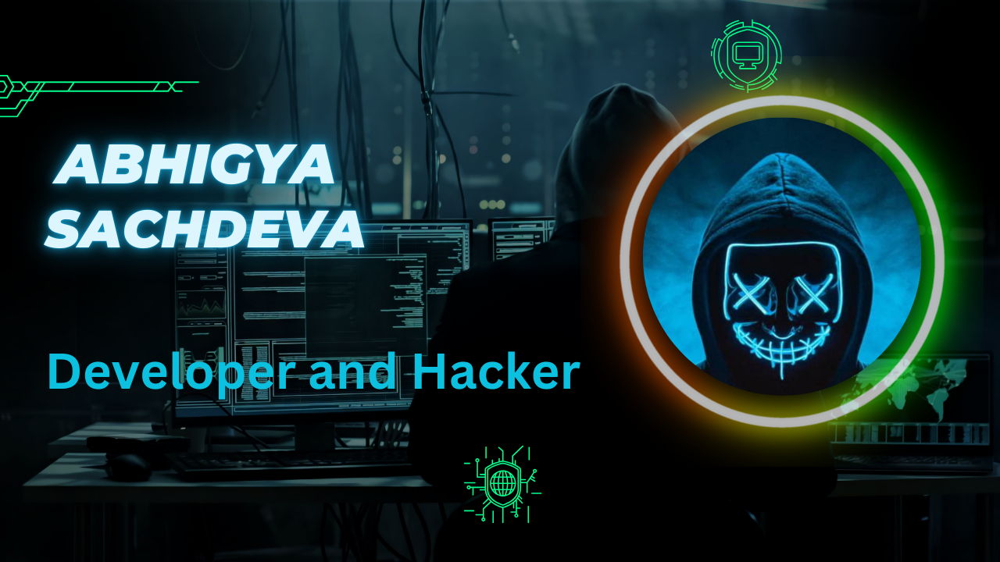

<h1 align="center">Abhigya Sachdeva</h1>
<h3 align="center">BTech Student</h3>

  Passionate about development and ethical hacking. I build secure, real-time web applications — and learn how to break &amp; defend them.

<!-- Icons: Lucide (via Iconify), single colour #7aa2f7, verified loading 2026-11-02 -->

-  **BTech. at Newton School of Technology, Rishihood University (2025–2028)** · CGPA **8.56/10**
-  **Open-source contributor to [GreedyBear](https://github.com/GreedyBear-Project/GreedyBear)** — a threat intelligence platform for honeypot (T-Pot) data: [5 merged PRs](https://github.com/GreedyBear-Project/GreedyBear/pulls?q=is%3Apr+author%3AABHIGYA0205+is%3Amerged) covering a TanStack Table v9 migration, cached API responses, and feed-statistics fixes — plus an [open security PR](https://github.com/GreedyBear-Project/GreedyBear/pull/1810) scoping feed share tokens to their owners, fixing an issue I reported
-  **Advent of Cyber 2025 — TryHackMe** ([certificate](https://tryhackme-certificates.s3-eu-west-1.amazonaws.com/THM-BLUZ6KOOIQ.pdf)): threat detection, networking, cryptography, web security &amp; incident response
-  Open to **open-source collaboration, freelance projects, and internships**
-  Portfolio: **[linux-portfolio-taupe.vercel.app](https://linux-portfolio-taupe.vercel.app/)** ·  Sonipat, Haryana, India
-  **[abhigyasachdeva2005@gmail.com](mailto:abhigyasachdeva2005@gmail.com)**

##  Featured Projects

| Project | Description | Stack highlights |
|---------|-------------|------------------|
| **[Whiteboard](https://github.com/ABHIGYA0205/whiteboard)** · [Live demo](https://whiteboard-client-pearl.vercel.app/) | Real-time collaborative whiteboard with infinite canvas, live cursors &amp; presence. Op-based sync with optimistic concurrency (HTTP 409 conflict detection), and Hugging Face AI for sketch-to-image &amp; prompt-to-diagram generation | Next.js · TypeScript · Node.js · Socket.io · MongoDB · Docker · Hugging Face |
| **[VoiceShield](https://github.com/ABHIGYA0205/voiceDetection)** | Real-time synthetic speech detection for live microphone streams &amp; uploaded audio. 4-second sliding-window streaming with speech gating — **34.5 ms p95 latency** on Apple M3 (MPS), evaluated across **71,237 ASVspoof trials** with fail-closed checks | Python · AASIST-L · FastAPI · WebSockets · React |
| **[QuickCommerce](https://github.com/ABHIGYA0205/Neerza_Ice_cream_parlour)** · [Live demo](https://neerza-ice-cream-parlour.vercel.app/) | Mobile-first e-commerce for a local dairy/ice-cream shop in Jaipur — product search &amp; filters, cart, WhatsApp ordering, and a JWT-secured admin dashboard for products, categories &amp; live inventory | Next.js · React · Tailwind CSS · Node.js · Express · MongoDB · Cloudinary · JWT |

##  Skills

**Languages**

**Frontend, Backend & APIs**

**AI / ML & Data**

`RAG` · `LangChain` · `LangGraph` · `Generative AI` · `Hugging Face` · `NumPy` · `Pandas` · `Matplotlib` · `seaborn` · `Tableau`

**Databases, DevOps & Tools**

**Cybersecurity**

`Nmap` · `Nuclei` · `FFUF` · `Katana` · `WhatWeb` · `HTTPX` · `Kali Linux` · `OWASP Top 10` · `Vulnerability Assessment` · `Web App Reconnaissance` · `SQL Injection` · `HTTP Security Headers` · `TCP/IP` · `DNS` · `HTTP/HTTPS`

##  GitHub Stats

<!-- Verified working on 2026-11-02: github-profile-summary-cards (HTTP 200, real SVG).
     NOT github-readme-stats.vercel.app — that public instance returns 503 DEPLOYMENT_PAUSED. -->

  

  
  

##  Connect

